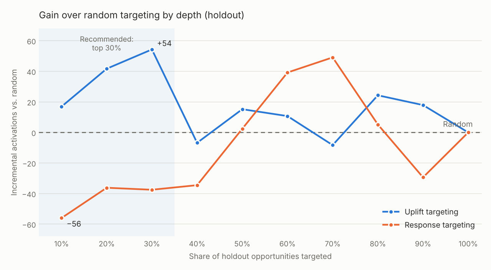

# Offer Targeting and Incrementality Analysis

**Author:** Corey Miller · [LinkedIn](https://linkedin.com/in/coreymiller-co) · [GitHub](https://github.com/CoreyJMiller22791)

## Executive Summary

This project shows how customer and campaign data can be turned into a data-driven marketing targeting strategy. Six synthetic raw datasets were loaded into DuckDB. SQL was used to build the analytical population and engineer historical features, and Python was used for modeling, validation and business analysis.

The first phase compared Logistic Regression with Gradient Boosting to predict which treated customer-campaign opportunities were most likely to activate. The second phase measured the campaign's average treatment effect. It then used separate treated and control Logistic Regression models (a two-model uplift approach, also called a T-learner) to estimate how much each opportunity's activation probability changed because of treatment.

Treatment increased activation by 6.9 percentage points across the holdout population. At 30% targeting depth, uplift targeting generated about 54 more incremental activations than random targeting and 92 more than response targeting. Through the top 40%, response targeting produced *fewer* incremental activations than random selection. Its highest-ranked customers were largely those who would have activated without the offer.



## Business Problem

The business needed to know whether the marketing treatment increased activation and how eligible customer-campaign opportunities should be prioritized. The analysis compared two targeting strategies:

- **Response targeting:** select opportunities most likely to activate when treated.
- **Uplift targeting:** select opportunities most likely to activate *because of* treatment.

The goal was to find which strategy produced the greatest incremental benefit at the same targeting depth.

## Data and Analytical Grain

The analysis used six synthetic source datasets:

| Dataset | Rows | Contents |
|---|---|---|
| `customers` | 5,000 | Signup date, region, age band, acquisition channel |
| `campaigns` | 12 | Retailer category, dates, contact limit, communication and redemption cost |
| `eligibility` | 31,800 | Customer-campaign eligibility and observation date |
| `assignments` | 31,800 | Treatment or control assignment |
| `transactions` | 29,723 | Transaction date, retailer category, revenue, gross margin |
| `offer_events` | 5,513 | Offer-activation events |

The twelve campaigns ran every two weeks from August 31, 2025 to February 1, 2026. Treatment was randomly assigned, with about 82% of eligible opportunities treated and 18% held out as control. Because assignment was random, the treated-versus-control difference estimates the offer's causal effect.

The analytical grain is one customer-campaign-observation-date record per row. Historical predictors are measured before the observation date and activation outcomes are measured afterward. The overall 30-day activation rate was 17.3%.

## SQL Feature Engineering and QA

SQL was used to engineer historical predictors using only information available before each observation date, when campaign targeting occurred: historical order count, historical revenue and days since the customer's last transaction.

The binary activation outcome captures whether a customer activated from the observation date through day 30. A 90-day category-matched revenue outcome was also built for future revenue analysis but is not used in this version.

Quality checks confirmed that:

- the eligibility and assignment tables each had exactly one row per customer-campaign, and every eligible record had a matching assignment
- the model population kept all 31,800 eligibility rows with no duplicates
- treatment and activation values were valid, with no unexpected missing or negative values
- missing recency occurred only for the 1,090 records with no prior transaction history

## Modeling Approach

**Preprocessing.** Numerical features were standardized for Logistic Regression, and categorical features were one-hot encoded. Missing values for days since last transaction were filled with zero and paired with a missing-history indicator. A zero would otherwise look like a purchase on the observation date, so the indicator lets the model separate customers with no history from recent buyers.

**Chronological split.** The six campaigns from August 31 to November 9, 2025 were used for training. The four campaigns from December 21, 2025 to February 1, 2026 formed the holdout. The two campaigns in between were excluded so every 30-day training outcome was complete before holdout scoring began.

| Population | Training | Gap (excluded) | Holdout |
|---|---|---|---|
| All records | 15,900 | 5,300 | 10,600 |
| Treated | 13,030 | 4,400 | 8,645 |
| Control | 2,870 | 900 | 1,955 |

**Response model.** Logistic Regression and Gradient Boosting were trained on treated records to predict activation under treatment.

**Uplift model.** A second Logistic Regression model was trained on control records. Both models scored every holdout opportunity, and estimated uplift was the predicted activation probability under treatment minus the predicted probability without treatment.

**Strategy evaluation.** The holdout was ranked by each model's score and cut into cumulative depths from 10% to 100%. At each depth, incremental activations were estimated as the observed treated-minus-control activation rate within the selected group, multiplied by the number of records selected. The random-targeting benchmark is the full-holdout incremental activations multiplied by the targeting share.

## Key Results

### Strategy comparison (holdout)

Incremental activations compared with random targeting at the same depth:

| Targeting depth | Uplift | Response | Uplift advantage over response |
|---|---|---|---|
| **10%** | **+16.9** | −56.0 | **+73.0** |
| **20%** | **+41.7** | −36.2 | **+77.9** |
| **30%** | **+54.3** | −37.5 | **+91.8** |
| 40% | −6.8 | −34.5 | +27.7 |
| 50% | +15.2 | +2.4 | +12.8 |
| 60% | +10.7 | +39.2 | −28.5 |
| 70% | −8.3 | +49.1 | −57.4 |
| 80% | +24.3 | +5.2 | +19.0 |
| 90% | +17.9 | −29.4 | +47.3 |
| 100% | 0.0 | 0.0 | 0.0 |

Uplift targeting was consistently ahead in the top 30%. Beyond that, neither strategy led reliably. Each uplift decile contains only about 195 control records, so the deeper comparisons are noisy.

The top response decile shows why response targeting underperformed. Those opportunities had the highest activation rates, but the control group activated almost as often (20.7%) as the treated group (22.3%). That is only 1.6 points of lift, against 6.9 points overall.

### Supporting results

- **Average treatment effect:** Treated holdout opportunities activated at 18.6% and control at 11.7%, a lift of 6.91 percentage points (95% CI: 5.27 to 8.56; 59% relative lift). Lift was positive in all four holdout campaigns, ranging from 6.00 to 8.39 points.

- **Response-model selection:** Logistic Regression was chosen over Gradient Boosting. Gradient Boosting fit the training data more closely but generalized worse. Its holdout log loss and Brier score were worse than the no-skill baseline.

  | Model (treated records) | Train ROC AUC | Holdout ROC AUC | Holdout avg. precision | Holdout log loss | Holdout Brier |
  |---|---|---|---|---|---|
  | Logistic Regression | 0.5568 | **0.5442** | **0.2109** | **0.4779** | **0.1506** |
  | Gradient Boosting | 0.6585 | 0.5362 | 0.2061 | 0.4811 | 0.1517 |
  | No-skill baseline | — | 0.5000 | 0.1858 | 0.4800 | 0.1513 |

- **Response-targeting performance:** The top 10% of response scores captured 12.0% of treated activations, with an activation rate 20% above the holdout average. The top 20% captured 23.5%, with a rate 17% above average.

- **Control-model performance:** Holdout ROC AUC was 0.5777, and average precision was 0.1561 against a no-skill baseline of 0.1166. Log loss and Brier score were also slightly better than baseline.

- **Uplift calibration:** Average predicted uplift was 5.49 points against an observed lift of 6.91 points. The models underestimated the overall effect by about 1.4 points (roughly 20%), so the uplift scores are better used for ranking than as point estimates of lift.

## Business Recommendation

Use the uplift model to prioritize the top 30% of customer-campaign opportunities. That is where it showed a consistent advantage over both random targeting and response targeting. Avoid ranking by response probability alone for shallow targeting. In the top 40%, it performed worse than random selection.

Beyond 30%, the ranking advantage is inconsistent, so decisions about targeting more customers should rest on campaign cost and customer value, not on model rank alone.

## Limitations

- **Synthetic data.** The results demonstrate the method. They are not evidence about a real business.
- **Modest predictive power.** Holdout ROC AUC was 0.54 for the response model and 0.58 for the control model. The rankings add value, but individual predictions are weak.
- **No uncertainty on strategy differences.** The average treatment effect has a confidence interval, but the strategy comparisons do not. Deeper-decile comparisons rest on small control groups.
- **Activations, not profit.** The source data includes communication cost, redemption cost and gross margin, but this version does not use them. Results are in incremental activations. The 90-day revenue outcome is also not yet analyzed.
- **Single holdout window.** Results come from one chronological split covering four campaigns.
- **Uplift underestimates the overall effect.** Predicted uplift was about 20% below observed lift.

## AI Decision Assistant

The campaign decision assistant lets users explore the strategy comparison by asking questions such as:

- Which strategy should I use when targeting 30% of customers?
- How do the recommendations change between 30% and 60%?
- How much does the leading strategy outperform the alternatives at 30% targeting?

The workflow separates interpretation, calculation and explanation:

1. A local language model (Qwen3 4B via Ollama) reads the question and returns the intent (activation or financial) and the requested targeting depths as JSON.
2. Python validates the request. It handles financial questions and missing depths, enforces a limit of three depths per question and accepts depths from 10% to 100% in 10-point steps. It then retrieves the exported estimates and calculates each comparison.
3. A second model call explains only the successful comparisons. Python adds any validation errors itself, so the model never explains an error result.

The language model never calculates campaign outcomes. Financial questions return a stated limitation, because the exported results contain activations only.

**Evaluation.** The assistant was developed over 19 instruction versions. The final version passed all 17 questions in the evaluation suite, which covers:
- single and multiple depths
- percentages, decimals and written shares such as "half" and "one fifth"
- unsupported depths and missing depths
- financial questions, including a reworded version
- mixed supported and unsupported inputs

It also passed a separate check that rejects requests with more than three depths. Median response time on a local machine was 4.2 seconds for one-call answers and 34.3 seconds for answers that needed a second explanation call. The test questions, findings for every version and the development history are in `campaign_decision_assistant.ipynb`.

## Tools Used

- **DuckDB and SQL:** Data loading, joins, feature engineering, outcome construction and quality validation
- **Python 3.11:** Modeling, evaluation, uplift analysis and strategy comparison
- **pandas and NumPy:** Data preparation, aggregation, validation and reporting
- **scikit-learn:** Preprocessing pipelines, Logistic Regression, Gradient Boosting and model-evaluation metrics
- **Matplotlib:** Cumulative gains and strategy comparison charts
- **Jupyter Notebook:** End-to-end development, documentation and presentation
- **Ollama and Qwen3:** Local language model for interpreting questions and explaining campaign comparisons

## Repository Structure

```text
offer-targeting-incrementality-analysis/
├── .gitignore
├── README.md
├── requirements.txt
├── offer_targeting_incrementality_analysis.ipynb   # Full analysis: SQL, modeling, strategy comparison
├── campaign_targeting_demo.ipynb                   # Runnable assistant demo
├── campaign_decision_assistant.ipynb               # Assistant development and 17-question evaluation
├── images/
│   └── strategy_gain_over_random.png
├── campaign_assistant_data/
│   ├── response_summary.csv                        # Exported by the analysis notebook
│   └── uplift_summary.csv                          # Exported by the analysis notebook
└── Raw Data/
    ├── assignments.csv
    ├── campaigns.csv
    ├── customers.csv
    ├── eligibility.csv
    ├── offer_events.csv
    └── transactions.csv
```

Running the notebooks also creates two local files: `offer_portfolio.duckdb` in the project folder (from the analysis notebook) and `assistant_demo_runs.jsonl` (a log of demo questions and answers).

## How to Run the Project

1. Install Python 3.11.
2. Clone the repository and install the packages:

   ```bash
   git clone https://github.com/CoreyJMiller22791/offer-targeting-incrementality-analysis.git
   cd offer-targeting-incrementality-analysis
   pip install -r requirements.txt
   ```

### Campaign analysis

1. Confirm that the six source CSV files are in the `Raw Data` folder.
2. Start Jupyter from the project folder with `jupyter notebook`.
3. Open `offer_targeting_incrementality_analysis.ipynb`, restart the kernel and select **Run All Cells**.

The notebook loads the source data, creates the DuckDB tables, trains the models, reproduces the strategy comparison and exports the two summary files the assistant uses. Models use `random_state=42`, so results are reproducible.

### Running the assistant demo

1. Install and start [Ollama](https://ollama.com).
2. Download the model:

   ```bash
   ollama pull qwen3:4b-instruct-2507-q4_K_M
   ```

3. Confirm that `response_summary.csv` and `uplift_summary.csv` are in the `campaign_assistant_data` folder. They are included in the repository, so the analysis notebook doesn't need to run first.
4. Open `campaign_targeting_demo.ipynb` and run the setup and function cells in order.
5. Run the live question cell and enter a question, such as:

   ```text
   Compare targeting at 30% and 60%. Recommend a strategy at each depth.
   ```

The assistant displays its answer and the comparison results supporting it. At 30% it recommends uplift targeting, and at 60% it recommends response targeting, matching the table above. Each question is handled independently and logged to `assistant_demo_runs.jsonl`.
